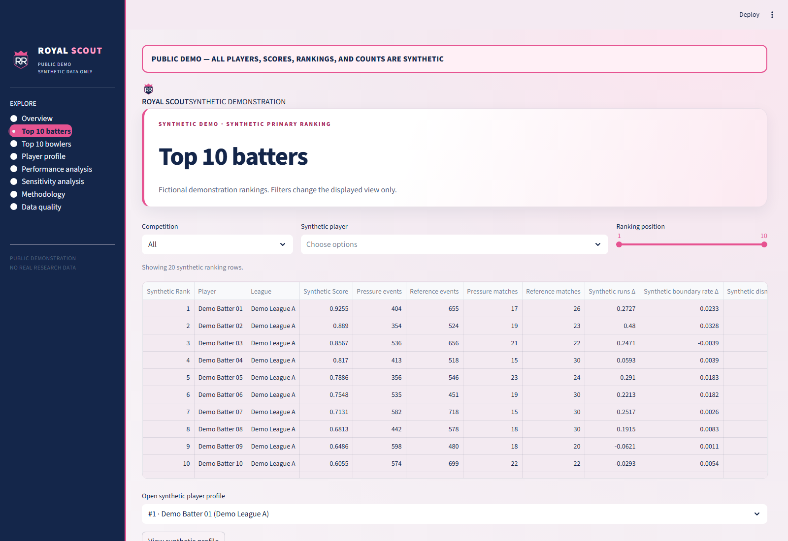
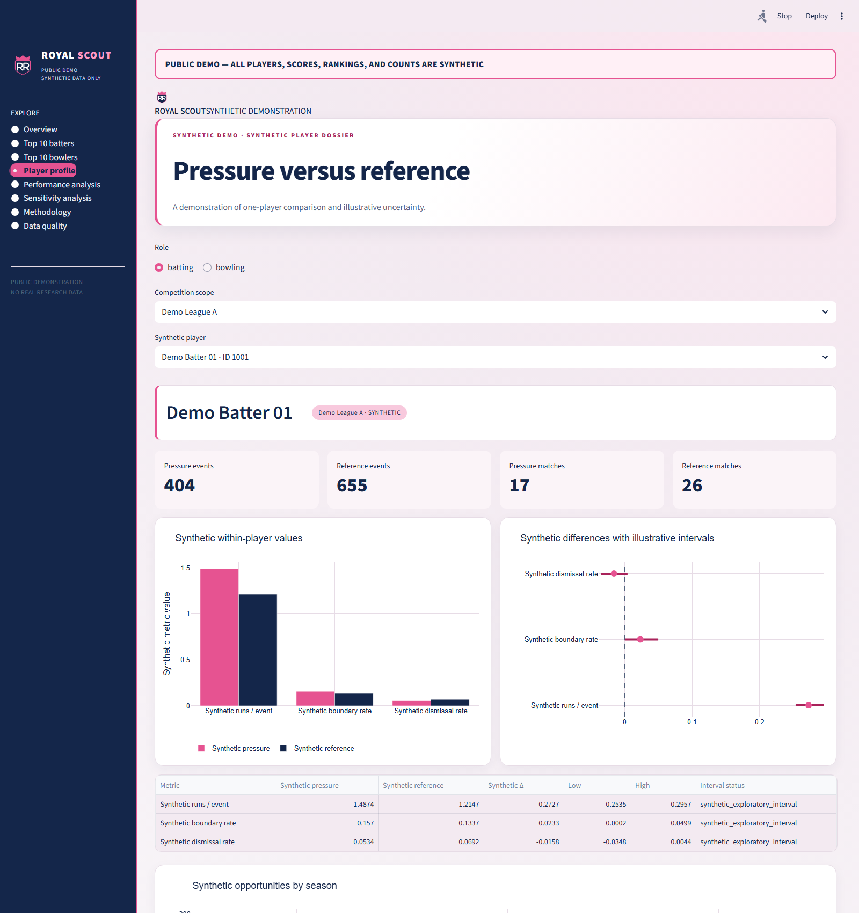
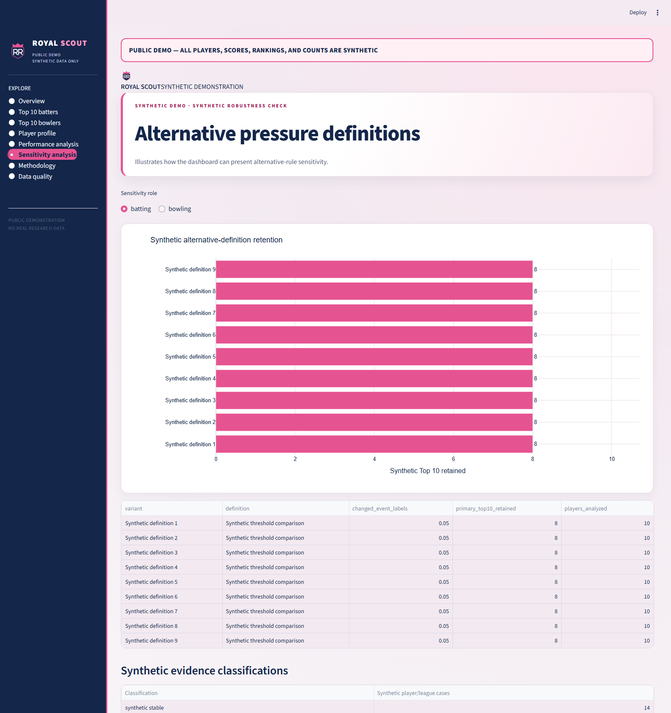

# ROYAL SCOUT

### A public, synthetic cricket analytics dashboard


ROYAL SCOUT presents an interactive research dashboard for exploring pressure versus reference performance in T20 cricket. This public edition demonstrates the interface, player profiles, ranking views, and sensitivity analysis with **fictional players and generated values**. It is a showcase of the product experience, not a publication of the private competition research.

> **Synthetic-data notice:** Every player, league, match, ranking, score, interval, and count shown here is generated for demonstration. None is an actual ROYAL SCOUT finding or a real cricket performance result. The app does not load the original competition data pack, processed research outputs, reports, or credentials.

## Explore the dashboard

| Top 10 batters | Top 10 bowlers |
| --- | --- |
|  |  |
| Fictional batter rankings with league and player filters. | Fictional bowler rankings with the same interactive filters. |

| Player profile | Sensitivity analysis |
| --- | --- |
|  |  |
| Generated pressure/reference values and illustrative intervals. | Demonstration of alternative definitions and stability displays. |

The eight pages are **Overview**, **Top 10 batters**, **Top 10 bowlers**, **Player profile**, **Performance analysis**, **Sensitivity analysis**, **Methodology**, and **Data quality**.

## Features

- Responsive pink and navy dashboard with an original ROYAL SCOUT monogram.
- Interactive fictional rankings, filters, and player navigation.
- Event-based comparison charts and illustrative interval displays.
- Alternative-definition sensitivity views and clear synthetic-data labels on every page.
- Deterministic in-memory data generation; no external API, database, or private file access.

## Technology

Python, Streamlit, Pandas, and Plotly. The versions needed to run the app are pinned in [`requirements.txt`](requirements.txt).

## Run locally

Use Python 3.11 or newer. From this directory:

```bash
python -m venv .venv
```

Activate the environment (`.venv\\Scripts\\Activate.ps1` on PowerShell, or `source .venv/bin/activate` on macOS/Linux), then run:

```bash
python -m pip install -r requirements.txt
python -m streamlit run app.py
```

Open the local URL printed by Streamlit, normally `http://localhost:8501`.

To run the optional demo tests, install `pytest` separately and run `python -m pytest -q tests`.

## Deploy the public demo

Use **the contents of this `public_demo/` directory as the repository root**. Set `app.py` as the Streamlit Community Cloud entry point. Keep the private parent project, competition data, processed outputs, and research reports outside that repository. No secrets are required by this demo.

## Repository layout

```text
.
├── app.py
├── dashboard/
│   ├── assets/rr_monogram.svg
│   ├── brand.py
│   ├── charts.py
│   ├── data.py
│   └── views.py
├── screenshots/
├── tests/test_public_demo.py
├── .streamlit/config.toml
├── .gitignore
├── requirements.txt
└── README.md
```
