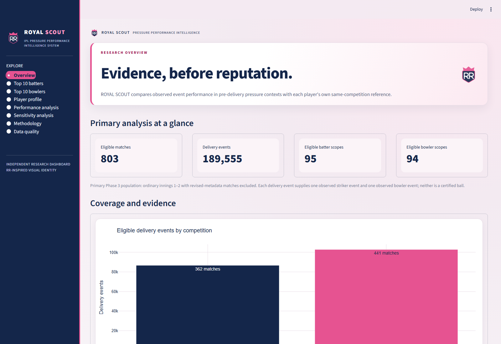
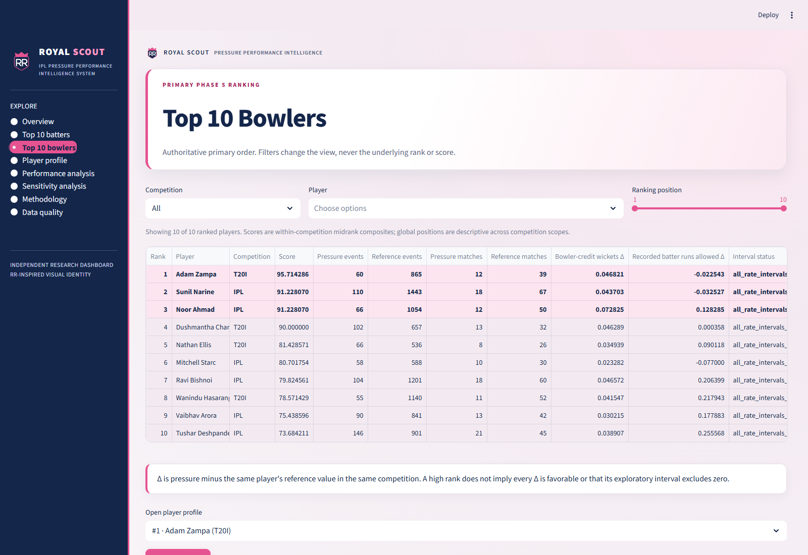

# ROYAL SCOUT

### IPL pressure performance intelligence system



ROYAL SCOUT is an independent, research-oriented Streamlit dashboard for comparing IPL and T20I player performance in **observable pre-delivery pressure contexts** with each player's reference performance in the **same competition**. It presents the validated Phase 5 rankings and Phase 5B alternative-pressure analysis. It does not rebuild rankings when the app runs.

The source competition CSVs and selected authoritative processed outputs are included with this public research edition at the project owner's direction. These are **real research results**, unlike the earlier synthetic demonstration. The project does not claim official Rajasthan Royals affiliation.

## Dashboard

| Batting rankings | Bowling rankings |
| --- | --- |
|  |  |
| Published Phase 5 player order, competition, evidence and metric differences. | Published Phase 5 bowler order with the same scope and evidence fields. |

| Player profile | Sensitivity analysis |
| --- | --- |
|  |  |
| Within-player pressure/reference metrics and exploratory match-cluster intervals. | Published Phase 5B alternative definitions and stability evidence. |

Eight pages are available: Overview, Top 10 batters, Top 10 bowlers, Player profile, Performance analysis, Sensitivity analysis, Methodology and Data quality.

## What the analysis measures

- **Pressure proxy:** innings phase combined with wickets already lost before the current delivery. Batting and bowling use separate rules. These labels do not establish psychological pressure.
- **Batting metrics:** recorded batter runs per observed striker event; valid boundary-flag events per observed striker event; striker-attributed dismissal events per observed striker event.
- **Bowling metrics:** bowler-credit wickets per observed bowler event; recorded batter runs allowed per observed bowler event.
- **Comparison:** each player's pressure and reference observations in the same competition. Rankings use eligible scopes and normalized metric contributions; uncertainty is presented separately through exploratory match-cluster intervals.
- **Sensitivity:** alternative phase/wicket thresholds can materially change ranking membership and interpretation.

Event counts are **not** certified balls faced or legal balls. The source cannot support exact team scores, conventional batting strike rate or average, exact bowler runs conceded, or bowling economy. Pressure/reference differences are associations, not causal effects. Many exploratory intervals include zero.

**Known ordering caveat:** the published Phase 5 batter list puts Karim Janat ahead of Hardik Pandya on a floating-point near-tie. Their exact normalized scores tie, and Phase 5B's rounded-score rank references reverse the two. The dashboard preserves the published Phase 5 order and warns about the Phase 5B reference discrepancy. Top 10 membership and the alternative performance metrics are unaffected; do not interpret their relative rank as meaningful separation.

## Technology and data

Python, Streamlit, Pandas and Plotly. App dependencies are pinned in [`requirements.txt`](requirements.txt). The original competition CSVs are in `6af3166e7b922_data_pack/`. The dashboard reads **15 specific CSVs** under `data/processed/phase2b/`, `phase3/`, `phase4_v4/`, `phase5/` and `phase5b/`, plus three output manifests. `dashboard/data.py` checks file schemas and SHA-256 hashes before displaying results. The app never downloads data or recalculates pressure labels, metrics, intervals or rankings.

Only the tables needed for the hosted dashboard are copied from the private research workspace. Older intermediate processing versions and private reports are not part of this repository. The original data pack is present for source transparency, but this repository is **not** the complete historical pipeline archive.

## Run locally

Use Python **3.13** to match the tested Streamlit environment. From the repository root:

```bash
python -m venv .venv
# Activate .venv for your shell, then:
python -m pip install -r requirements.txt
python -m streamlit run app.py
```

Open the local URL printed by Streamlit. The dashboard is read-only. For the optional app tests, install `pytest` separately and run `python -m pytest -q tests`.

## Deploy on Streamlit Community Cloud

1. Push this repository, including its required `data/processed/` CSVs and manifests, to GitHub.
2. At [share.streamlit.io](https://share.streamlit.io/), create an app from `svpda33/royal-scout-dashboard`, branch `main`, entry point `app.py`.
3. Choose Python **3.13** in Advanced settings and deploy. No app secrets are needed.
4. Check the Cloud build log and open all eight pages. Verify player navigation, filters, charts, data-quality messages and the sensitivity caveat.

The app depends on the exact included files. A code-only checkout or a commit that omits the processed outputs will fail the intentional hash validation.

## Project layout

```text
app.py
dashboard/                       Read-only views, charts, loader and original monogram
6af3166e7b922_data_pack/       Supplied source competition CSVs
data/processed/                 Selected authoritative validated CSVs and manifests
screenshots/                    Captures from the real running dashboard
tests/                          Hosted-dashboard smoke and data-integrity tests
.streamlit/config.toml
requirements.txt
```
